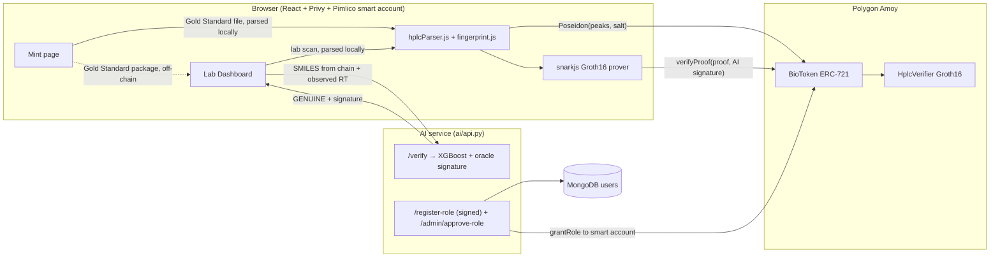

# BioToken System Verification and Operating Guide

Last verified on 2026-10-11, after the security redesign described in [section 9](#9-findings-and-what-changed). Every result here comes from a command in [section 8](#8-how-to-run-and-re-verify-everything) and can be re-run. The live end-to-end run on Polygon Amoy is recorded in [docs/evidence/](evidence/).

**Contents**

1. [Verdict at a glance](#1-verdict-at-a-glance)
2. [Architecture](#2-architecture)
3. [Repository map](#3-repository-map)
4. [Layer by layer: how it works and what was verified](#4-layer-by-layer)
5. [End-to-end walkthrough](#5-end-to-end-walkthrough)
6. [HPLC upload files (what to upload during verification)](#6-hplc-upload-files)
7. [Test results and the live Amoy run](#7-test-results-and-the-live-amoy-run)
8. [How to run and re-verify everything](#8-how-to-run-and-re-verify-everything)
9. [Findings and what changed](#9-findings-and-what-changed)
10. [Known limitations and next steps](#10-known-limitations-and-next-steps)

---

## 1. Verdict at a glance

| Layer | Status | Evidence |
|---|---|---|
| Smart contracts | Redesigned and redeployed. Lifecycle calls are holder-only, plain transfers are blocked, `verifyDemo` is gone, and the contract supplies every ZK public input itself. 26 Hardhat tests pass | `npx hardhat test` |
| ZK circuit | Rewritten from circomlib parts. It now proves "the lab's scan matches the Gold Standard committed at mint, within the tolerance fixed at mint, for this token". New phase-2 setup on the PSE Perpetual Powers of Tau. A tampered scan has no proof; replay and loosened-tolerance proofs are rejected | Hardhat I-1…I-9, `check_samples.mjs`, [circuits/SETUP.md](../circuits/SETUP.md) |
| AI pipeline | Models unchanged; paper metrics reproduce exactly. A GENUINE verdict is now signed by an AI oracle key, and BioToken requires that signature | 48 Python tests, `reproduce_paper_metrics.py` |
| Roles / API | Role requests must be signed by the wallet and approved by an admin (or auto-approved in demo mode). Roles go to the smart account that actually sends the transactions | Python tests, Amoy run |
| Consensus layer | Unchanged: a browser-side check against two hard-coded supplier fingerprints. Not enforced on-chain | code review |
| Full integration, local | **Works**: mint → ship → receive → signed AI verdict → ZK proof → on-chain verify → consume. Tampered and RT-shifted scans stop at the right step | `npx hardhat run scripts/integrate.js` |
| Full integration, Polygon Amoy (gasless) | **Works**: the same flow through Pimlico smart accounts and sponsored UserOperations, the browser's parser, fingerprint and circuit files, and the live AI service | `node frontend/scripts/e2e_amoy.mjs`, [evidence](evidence/amoy-e2e-2026-10-11T05-49-49-840Z.json) |
| Web app | Builds; renders against the new contract (landing, token details for the Amoy tokens). Flows behind a Privy login were exercised through the end-to-end script rather than by a person in a browser | `vite build`, headless browser |

**Deployment (Polygon Amoy, 2026-10-11)**

| Contract | Address |
|---|---|
| BioToken | [`0x59B06aE32e732bb3D91b0F301af6791A0C98b202`](https://amoy.polygonscan.com/address/0x59B06aE32e732bb3D91b0F301af6791A0C98b202) |
| HplcVerifier | [`0xA44699310aE4599cF43C1dBe68B227f3cb4E16DA`](https://amoy.polygonscan.com/address/0xA44699310aE4599cF43C1dBe68B227f3cb4E16DA) |
| AI oracle (`AI_ORACLE_ROLE`) | `0x5653dc3ef59c4E3d854e0fEB94529A335460c68e` |

Recorded in [deployments/amoy.json](../deployments/amoy.json), now committed. The previous BioToken (`0x9204…9425`) and its tokens and role grants do not carry over.

---

## 2. Architecture



Three checks protect a batch, and both lab-side checks are now enforced on-chain:

1. **Consensus** (manufacturer, at mint): the Gold Standard must be within ±50 of known-good supplier fingerprints. Browser-side only.
2. **AI pre-screen** (lab): the retention time the lab measures must agree with the RT predicted from the reagent recorded on the token. The verdict is signed; BioToken checks the signature.
3. **ZK proof** (lab): the lab's HPLC peaks match the manufacturer's Gold Standard within the tolerance stored at mint, without revealing either fingerprint. BioToken checks the proof against its own stored commitment, tolerance and the token id.

---

## 3. Repository map

| Path | What it is |
|---|---|
| [contracts/BioToken.sol](../contracts/BioToken.sol) | ERC-721 + AccessControl: lifecycle, roles, commitment storage, AI-signature and proof checks |
| [contracts/HplcVerifier.sol](../contracts/HplcVerifier.sol) | snarkjs-generated Groth16 verifier (3 public signals); only the contract name was changed |
| [contracts/MockVerifier.sol](../contracts/MockVerifier.sol) | Test double |
| [circuits/fingerprint.circom](../circuits/fingerprint.circom) | `FingerprintMatch(10)` |
| [circuits/SETUP.md](../circuits/SETUP.md) | How the circuit was compiled and the trusted setup run, with file hashes |
| [circuits/build/](../circuits/build/) | `.r1cs`, `.sym`, `.wasm`, `fingerprint_final.zkey`, `verification_key.json`, `ppot_0080_12.ptau` |
| [ai/api.py](../ai/api.py) | AI verdict + oracle signature, role registration and approval, peak extraction |
| [ai/src/verifier.py](../ai/src/verifier.py), [features.py](../ai/src/features.py) | Model loading and the 137 RDKit features (unchanged) |
| [frontend/src/lib/fingerprint.js](../frontend/src/lib/fingerprint.js) | Poseidon commitment, Gold Standard package, circuit inputs, proof formatting (shared by browser, scripts and tests) |
| [frontend/src/lib/hplcParser.js](../frontend/src/lib/hplcParser.js) | HPLC file parsing and peak extraction (shared) |
| [frontend/src/lib/consensusValidator.js](../frontend/src/lib/consensusValidator.js) | Consensus check |
| [frontend/src/lib/pimlico.js](../frontend/src/lib/pimlico.js) | Smart account + Pimlico paymaster; `getSmartAccountAddress` |
| [frontend/src/hooks/useGaslessContract.js](../frontend/src/hooks/useGaslessContract.js) | Mint flow |
| [frontend/src/hooks/useLabVerification.js](../frontend/src/hooks/useLabVerification.js) | Lab flow |
| [frontend/src/hooks/useRole.js](../frontend/src/hooks/useRole.js) | Signed role registration |
| [scripts/deploy.js](../scripts/deploy.js) | Deploys both contracts, writes `deployments/<network>.json`, updates `.env` files |
| [scripts/integrate.js](../scripts/integrate.js) | Full lifecycle on a local chain |
| [frontend/scripts/e2e_amoy.mjs](../frontend/scripts/e2e_amoy.mjs) | Full gasless lifecycle on Amoy, writes evidence |
| [scripts/grantRoles.js](../scripts/grantRoles.js) | Grant a role from the admin key |
| [samples/hplc/](../samples/hplc/) | Upload files (section 6) |
| [test/](../test/), [ai/tests/](../ai/tests/) | Hardhat and Python tests |

---

## 4. Layer by layer

### 4.1 Smart contracts

**Roles**: `DEFAULT_ADMIN_ROLE` and `MANUFACTURER_ROLE` go to the deployer; `AI_ORACLE_ROLE` goes to the oracle address passed to the constructor. `MANUFACTURER_ROLE` and `LAB_ROLE` are granted by the admin (through the API's approval step or `scripts/grantRoles.js`). The unused `LOGISTICS_ROLE` was removed.

**Stored per token**: `batchId`, `reagentSmiles`, `expiry`, `fingerprintCommitment` (Poseidon of the Gold Standard + salt), `tolerance` (0–255), `status`, `marketplaceSig`.

| Function | Status change | Who may call | Checks |
|---|---|---|---|
| `mintToken(batchId, smiles, expiry, commitment, tolerance, sig)` | → MINTED | `MANUFACTURER_ROLE` | commitment non-zero and inside the BN254 field, expiry in the future, SMILES not empty |
| `transferCustody(id, lab)` | MINTED → IN_TRANSIT | token holder or approved operator | recipient holds `LAB_ROLE` |
| `confirmReceipt(id)` | IN_TRANSIT → RECEIVED | `LAB_ROLE` **and** holder | |
| `verifyProof(id, a, b, c, aiAttestation)` | RECEIVED → VERIFIED | `LAB_ROLE` **and** holder | not expired; `aiAttestation` recovers to an `AI_ORACLE_ROLE` address over `aiVerdictDigest(id)`; Groth16 proof valid for `[commitment, tolerance, id]` read from storage |
| `consumeToken(id)` | VERIFIED → CONSUMED | holder | |
| `aiVerdictDigest(id)` | view | – | `keccak256(abi.encode("BioToken AI verdict: GENUINE", chainid, this, id, keccak256(reagentSmiles)))` |
| `getTokenData(id)`, `totalMinted()` | view | – | |

Plain `transferFrom`/`safeTransferFrom` revert with `TransferNotAllowed`: tokens move only through `transferCustody`.

Gas: `verifyProof` ≈ 258,700 (Groth16 pairing + ECDSA recovery).

### 4.2 ZK circuit (`FingerprintMatch(10)`)

| Signal | Visibility | Meaning |
|---|---|---|
| `labPeaks[10]` | private | the lab's measured peaks (0–255) |
| `goldPeaks[10]` | private | the manufacturer's Gold Standard peaks (0–255) |
| `salt` | private | random, chosen at mint |
| `commitment` | public | `Poseidon(goldPeaks, salt)`, stored at mint |
| `tolerance` | public | per-peak tolerance, stored at mint |
| `tokenId` | public | binds the proof to one token |

Constraints: every peak and the tolerance pass `Num2Bits(8)`; Poseidon of the Gold Standard and salt equals the commitment; for every i, `labPeaks[i] ≤ goldPeaks[i] + tolerance` and `goldPeaks[i] ≤ labPeaks[i] + tolerance` (`LessEqThan(10)`); `tokenId` takes part in a constraint. There is no `valid` output: if the scan doesn't match, no witness exists and no proof can be made. Size: 1,939 constraints. Proof time ≈ 1–1.5 s in Node (longer in a browser).

Because BioToken builds the public signals from its own storage, the lab cannot choose the threshold, cannot swap in a different Gold Standard, and cannot reuse a proof made for another token.

Setup: phase 1 from the PSE Perpetual Powers of Tau (contribution 80, 2^12); phase 2 is one random contribution plus a beacon, and `zkey verify` passes. See [circuits/SETUP.md](../circuits/SETUP.md). The deployed verifier's bytecode equals the local compile.

### 4.3 AI pipeline

```
SMILES (from the token) ──RDKit──► 137 features ──► XGBoost RT predictor ──► predicted RT
observed RT (typed by lab) ──► pct_deviation = |obs − pred| / pred
features + observed RT + deviation ──► XGBoost classifier ──► P(anomaly)
P(anomaly) < 0.50 → GENUINE → oracle signs aiVerdictDigest(chain, contract, token, SMILES)
```

The models, features and thresholds are unchanged from the earlier verification:

| Input | Deviation | P(anomaly) | Verdict |
|---|---|---|---|
| Caffeine at its predicted RT (636.2 s) | 0% | 0.012 | GENUINE |
| Caffeine ±10% | 10% | 0.088–0.472 | GENUINE |
| Caffeine −15% / +15% | 15% | 0.455 / 0.767 | GENUINE / ANOMALY |
| Caffeine +30% | 30% | 0.9998 | ANOMALY |
| 600 held-out SMRT molecules at measured RT | – | – | 88.3% GENUINE (≈ 11.7% false alarms) |
| Same molecules at RT +30% / −30% | – | – | 91.7% / 97.8% flagged |

Paper metrics reproduce exactly (R² 0.7706, RMSE 83.49 s; AUC 0.9798; at 0.50: detection 92.0%, FPR 4.9%, F1 0.9351; confusion TN 14,363 / FP 738 / FN 1,251 / TP 14,330), as does Layer 2 (15/15). See [AI_VALIDATION_RECONCILIATION.md](../AI_VALIDATION_RECONCILIATION.md).

The oracle signs only when `/verify` is given the SMILES (it then computes the features itself) and the verdict is GENUINE. Requests with precomputed features get a verdict but no signature.

### 4.4 Consensus layer

[consensusValidator.js](../frontend/src/lib/consensusValidator.js) compares the Gold Standard with two hard-coded supplier fingerprints (per-peak mean `[253, 243, 237, 232, 227, 221, 217, 211, 207, 199]`, tolerance ±50). It runs in the browser before mint; nothing on-chain checks it, and `marketplaceSig` is `0x`.

### 4.5 API service

| Endpoint | Purpose |
|---|---|
| `POST /verify` | `{smiles, observed_rt, token_id, chain_id, contract_address}` → verdict, plus `attestation` (oracle signature) when GENUINE |
| `POST /compute-features` | SMILES → 137 features (display/diagnostics) |
| `POST /extract-peaks` | Chromatogram CSV → 10 peaks, same rules as the browser parser (for scripts) |
| `POST /register-role` | `{wallet_address, role, smart_account_address, issued_at, signature}`; signature by the wallet over the registration message; returns 202 pending unless `ROLE_AUTO_APPROVE=true` |
| `GET /admin/role-requests` | Pending registrations (`X-Admin-Token`) |
| `POST /admin/approve-role/{wallet}` | Approves and grants the role to the registered smart account (`X-Admin-Token`) |
| `POST /api/retry-role-grant/{wallet}` | Retries a failed grant for an approved user |
| `GET /api/user/{wallet}`, `PATCH .../login`, `GET /health` | User lookup; health shows the oracle and contract address |

Removed: `/generate-proof` and `ai/src/prover.py`. Server-side proving would require uploading the secret Gold Standard.

Server configuration (repo-root `.env`): `AI_ORACLE_PRIVATE_KEY`, `ADMIN_API_TOKEN`, `VITE_CONTRACT_ADDRESS`, `AMOY_RPC_URL`, `DEPLOYER_PRIVATE_KEY` (admin key used for grants), `MONGODB_URI`; optional `ROLE_AUTO_APPROVE=true` (demo mode) and `CORS_ORIGINS`.

### 4.6 Frontend

Privy handles login and creates an embedded wallet. Every write goes through a SimpleSmartAccount (ERC-4337, EntryPoint 0.7) sponsored by Pimlico, so `msg.sender` is the smart account. Roles are granted to that address, and the Lab Dashboard shows it as the lab's shipping address. HPLC files are parsed in the browser on both pages; nothing but the SMILES, RT, commitment and proof leaves the browser. The old "ZK verified" badge, which proved synthetic peaks, was removed. Token Details now shows the commitment, tolerance and reagent, and marks a token verified only from its on-chain status.

---

## 5. End-to-end walkthrough

| # | Who | Where | What happens | Leaves the browser |
|---|---|---|---|---|
| 1 | Any user | Role selection | Picks a role; the wallet signs the registration message; the API stores it as pending | wallet, smart-account address, signature |
| 2 | Admin | API | `POST /admin/approve-role/{wallet}` → `grantRole` to the smart account | – |
| 3 | Manufacturer | Mint page | Uploads the Gold Standard file ([6.1](#61-manufacturer-mint-page)), enters batch ID, reagent SMILES, tolerance (default 10), expiry | none |
| 4 | Manufacturer | Mint page | Consensus check; random salt; `commitment = Poseidon(peaks, salt)`; `mintToken` as a sponsored UserOperation | batch ID, SMILES, commitment, tolerance |
| 5 | Manufacturer | Mint page | Downloads the **Gold Standard package** and sends it to the lab with the shipment (off-chain, privately) | – (manual hand-over) |
| 6 | Manufacturer | Token Details | "Ship to Lab" with the lab's address from its dashboard → IN_TRANSIT | – |
| 7 | Lab | Token Details | "Confirm Receipt" → RECEIVED | – |
| 8 | Lab | Lab Dashboard | Enters the token id; reagent, commitment and tolerance load from chain | – |
| 9 | Lab | Lab Dashboard | Uploads its chromatogram CSV and the Gold Standard package; the page shows lab vs gold per peak | none |
| 10 | Lab | Lab Dashboard | Types the observed RT → `/verify` → GENUINE + oracle signature (ANOMALY stops here) | SMILES, RT |
| 11 | Lab | Lab Dashboard | snarkjs proof in the browser → `verifyProof(id, proof, signature)` → VERIFIED | proof |
| 12 | Lab | Token Details | "Consume Reagent" → CONSUMED | – |

---

## 6. HPLC upload files

All files are in [samples/hplc/](../samples/hplc/). They are synthetic but shaped like real exports (header row, `Time (s),Absorbance (mAU)`, 0.5 s sampling, ten Gaussian peaks on a drifting baseline). Regenerate with `python samples/hplc/generate_samples.py`. Expected results are in [manifest.json](../samples/hplc/manifest.json) and are checked automatically (section 8.5).

**Accepted formats** (both pages, parsed in the browser by [hplcParser.js](../frontend/src/lib/hplcParser.js)):

| Format | Content |
|---|---|
| `.csv` chromatogram | `time,intensity` rows (header optional, scientific notation fine); the 10 tallest local maxima are taken, tallest first, scaled to 255. At least 10 peaks needed |
| `.csv` single row | 10 comma-separated integers 0–255 |
| `.json` | `{"peaks": [10 integers 0–255]}` |
| `.txt` | 10 integers separated by spaces, commas or newlines |

Files with fewer or more than 10 values, or values outside 0–255, are rejected (nothing is padded or clamped any more). The Lab Dashboard takes the chromatogram as `.csv`.

### 6.1 Manufacturer (Mint page)

| File | Batch ID | Reagent SMILES | Extracted peaks | Result |
|---|---|---|---|---|
| [BATCH-CAF-001_gold_standard.csv](../samples/hplc/manufacturer/BATCH-CAF-001_gold_standard.csv) | `BATCH-CAF-001` | `CN1C=NC2=C1C(=O)N(C(=O)N2C)C` | `[255,242,237,232,227,222,218,212,208,200]` | consensus PASS → minted |
| [BATCH-SMRT-53193463_gold_standard.csv](../samples/hplc/manufacturer/BATCH-SMRT-53193463_gold_standard.csv) | `BATCH-SMRT-53193463` | `c1ccc(-c2oncc2CN2CCN(c3ccccn3)CC2)cc1` | `[255,242,237,232,227,222,217,212,208,200]` | consensus PASS → minted |
| [BATCH-SMRT-49677779_gold_standard.csv](../samples/hplc/manufacturer/BATCH-SMRT-49677779_gold_standard.csv) | `BATCH-SMRT-49677779` | `O=C(c1ccccc1F)N1CCC(COCc2ccccc2)CC1` | `[255,242,237,232,227,222,217,211,208,200]` | consensus PASS → minted |
| [BATCH-JSON-001_gold_standard.json](../samples/hplc/manufacturer/BATCH-JSON-001_gold_standard.json) | `BATCH-JSON-001` | `CC(=O)OC1=CC=CC=C1C(=O)O` | as in file | consensus PASS → minted |
| [NEGATIVE_consensus_fail.json](../samples/hplc/manufacturer/NEGATIVE_consensus_fail.json) | `BATCH-NEG-001` | any | as in file | consensus FAIL (positions 1, 2, 4, 7 outside ±50) → blocked before any transaction |

Use tolerance **10** (the default) for the results below. Content of the JSON files:

```json
{ "peaks": [250, 244, 238, 232, 227, 221, 216, 211, 206, 200] }
```

```json
{ "peaks": [255, 120, 118, 230, 60, 221, 216, 90, 206, 200] }
```

First rows of every chromatogram:

```csv
Time (s),Absorbance (mAU)
0.0,2.001
0.5,2.029
...
```

**The Gold Standard package** (downloaded after minting, uploaded by the lab). It contains the secret fingerprint, so send it only to the receiving lab:

```json
{
  "type": "biotoken-gold-standard",
  "version": 1,
  "tokenId": "0",
  "batchId": "BATCH-SMRT-53193463",
  "reagentSmiles": "c1ccc(-c2oncc2CN2CCN(c3ccccn3)CC2)cc1",
  "contract": "0x59B06aE32e732bb3D91b0F301af6791A0C98b202",
  "chainId": 80002,
  "peaks": [255, 242, 237, 232, 227, 222, 217, 212, 208, 200],
  "salt": "<random decimal>",
  "tolerance": 10,
  "commitment": "0x…"
}
```

The Lab Dashboard rejects a package whose peaks and salt don't hash to its commitment, whose commitment differs from the token's, or whose token id or tolerance differs.

### 6.2 Lab Dashboard (HPLC verification)

For each row: mint the batch from its Gold Standard file (6.1), ship it to the lab, confirm receipt, then on the Lab Dashboard upload the lab CSV and the Gold Standard package and type the RT.

| Lab file | Gold Standard | Observed RT (s) | Lab peaks | Max \|lab − gold\| | AI | Outcome |
|---|---|---|---|---|---|---|
| [BATCH-CAF-001_lab_scan_genuine.csv](../samples/hplc/lab/BATCH-CAF-001_lab_scan_genuine.csv) | CAF-001 | 636.2 | `[255,242,238,230,226,224,216,210,210,200]` | 2 | GENUINE (p 0.012) | proof → **VERIFIED** |
| [BATCH-CAF-001_lab_scan_rt_shifted.csv](../samples/hplc/lab/BATCH-CAF-001_lab_scan_rt_shifted.csv) | CAF-001 | 827.1 | `[255,244,235,230,226,221,218,210,209,201]` | 2 | ANOMALY (p 0.9998) | stops at the AI step |
| [BATCH-CAF-001_lab_scan_tampered.csv](../samples/hplc/lab/BATCH-CAF-001_lab_scan_tampered.csv) | CAF-001 | 636.2 | `[255,244,231,224,210,202,191,180,175,168]` | 33 | GENUINE | **no proof possible**, stays RECEIVED |
| [BATCH-SMRT-53193463_lab_scan_genuine.csv](../samples/hplc/lab/BATCH-SMRT-53193463_lab_scan_genuine.csv) | SMRT-53193463 | 603.4 | `[255,241,238,234,228,222,219,212,207,200]` | 2 | GENUINE (p 0.015) | proof → **VERIFIED** |
| [BATCH-SMRT-49677779_lab_scan_genuine.csv](../samples/hplc/lab/BATCH-SMRT-49677779_lab_scan_genuine.csv) | SMRT-49677779 | 945.2 | `[255,243,236,230,227,221,218,211,207,202]` | 2 | GENUINE (p 0.016) | proof → **VERIFIED** |
| [BATCH-SMRT-49677779_lab_scan_rt_shifted.csv](../samples/hplc/lab/BATCH-SMRT-49677779_lab_scan_rt_shifted.csv) | SMRT-49677779 | 661.6 | `[255,241,235,231,228,220,219,213,206,201]` | 2 | ANOMALY (p 0.9999) | stops at the AI step |

Notes:

- The SMILES isn't typed by the lab: it comes from the token, so the AI always judges the reagent recorded at mint.
- **Use the SMRT batches for an honest demo.** PubChem CIDs 53193463 and 49677779 come from the RT predictor's held-out test split, and 603.4 s / 945.2 s are their measured METLIN SMRT RTs. Caffeine passes the AI step because 636.2 s is the model's own prediction.
- The RT the lab types is what the AI uses; the extractor ignores the time column.
- The two RT-shifted scans match the fingerprint but fail the AI; the tampered scan passes the AI but cannot be proven. Each check catches what the other misses.

---

## 7. Test results and the live Amoy run

| Suite | Command | Result |
|---|---|---|
| Hardhat: lifecycle, access control, AI attestation (mock verifier) | `npx hardhat test` | 17 passing |
| Hardhat: real Groth16 verifier and proofs (replay, wrong commitment, loosened tolerance, tampered proof, impossible witnesses) | same | 9 passing |
| Python: features, models, API, signed verdicts, signed role registration + approval, sample files | `cd ai && python -m pytest tests` | 48 passed |
| Sample files through the browser parser, consensus, commitment and real proofs | `node samples/hplc/check_samples.mjs` | 11/11 as expected |
| Local lifecycle (genuine / tampered / RT-shifted) | `npx hardhat run scripts/integrate.js` | SUCCESS / halted at ZK / halted at AI |
| Live gasless lifecycle on Amoy | `node frontend/scripts/e2e_amoy.mjs` | PASS (below) |
| Deployed verifier bytecode vs local compile | read-only check | identical |
| Frontend build; landing and token pages against the new contract | `vite build`, headless Chrome | builds; pages render |
| Paper metrics, Layer 2 | `python ai/reproduce_paper_metrics.py`, `python ai/layer2_validation_logged.py` | identical to the reconciliation document |

**Live run on Amoy** (2026-10-11, [full record](evidence/amoy-e2e-2026-10-11T05-49-49-840Z.json)). Fresh keys stood in for the Privy wallets: manufacturer smart account `0xFB8c…2289`, lab smart account `0x4B17…86fb`. All UserOperations were sponsored by the Pimlico policy.

| Step | Result | Transaction |
|---|---|---|
| Manufacturer: signed registration → admin approval → `MANUFACTURER_ROLE` on smart account | ✓ | [0xd22ce60f…](https://amoy.polygonscan.com/tx/0xd22ce60f4ef6a1be9abcfed692ac6fa76fea5349717224f5e50692c239cd79f7) |
| Lab: same → `LAB_ROLE` | ✓ | [0x96830338…](https://amoy.polygonscan.com/tx/0x968303387c60e1caf0e15c2c5df4ef3342f0df5df4e609821b22b89fca4361eb) |
| Batch A (SMRT-53193463): mint → token #0 | ✓ | [0xdcb1d630…](https://amoy.polygonscan.com/tx/0xdcb1d630bdbbb77e4ceec1aff47d460f69d0ac4dff55cc1ece8c34427d3f1912) |
| Ship to lab | ✓ | [0x32a16adc…](https://amoy.polygonscan.com/tx/0x32a16adca517a8e3e9d1faacf93fdeefd94f517c1cc42109bdbc48697eb7ae75) |
| Lab confirms receipt | ✓ | [0x9ecae23c…](https://amoy.polygonscan.com/tx/0x9ecae23c39cf19d4f759de41903572caab2ecef6391c9611c8a52417b373d7bf) |
| AI: RT 603.4 s vs predicted 607.3 s, p 0.0153 → GENUINE, signed | ✓ | – |
| ZK proof (max \|lab−gold\| 2 ≤ 10) | ✓ 1.0 s | – |
| `verifyProof` → VERIFIED | ✓ | [0x6bbc8161…](https://amoy.polygonscan.com/tx/0x6bbc81611b52de13d8eebee616ead9f23d30d5390e2aaa12b221e3a3f493f12c) |
| `consumeToken` → CONSUMED | ✓ | [0xcd0ef69f…](https://amoy.polygonscan.com/tx/0xcd0ef69f03109568a64be66da87500fd5cb131425776e4d6e85269a1e929914d) |
| Batch B (tampered caffeine): mint → token #1, ship, receive | ✓ | [0xa98a483e…](https://amoy.polygonscan.com/tx/0xa98a483ee493e81dc2b3efb12c2047e07bb51ad6aa5655e84e8aa33db2d72802), [0x74151e6d…](https://amoy.polygonscan.com/tx/0x74151e6dc162d06e200bef02a4a19f4e98f5a1fd05f196d723c518be7a453269), [0xfac65c94…](https://amoy.polygonscan.com/tx/0xfac65c94ecc78f9875898aaf5a8e21ddc8ebb36dbf80eb1bb3d84d1e6f930f45) |
| AI on token #1 → GENUINE (RT is right) | ✓ | – |
| No proof exists (max \|lab−gold\| 33 > 10) | ✓ | – |
| Token #0's proof replayed on token #1 | reverts `ZKProofInvalid` | – |
| AI verdict signed by the lab instead of the oracle | reverts `AiAttestationInvalid` | – |
| Manufacturer tries to confirm the lab's receipt | reverts `AccessControlUnauthorizedAccount` | – |
| Lab tries a plain ERC-721 transfer | reverts `TransferNotAllowed` | – |
| Lab tries to consume the unverified batch | reverts `InvalidStatusTransition` | – |
| Token #1 stays RECEIVED | ✓ | – |

The two MongoDB user records created by the run were deleted afterwards.

---

## 8. How to run and re-verify everything

### 8.1 Setup

```bash
npm install
cd frontend && npm install && cd ..        # also provides circomlibjs for scripts/tests
python -m venv .venv && .venv/Scripts/pip install -r requirements.txt   # .venv/bin on macOS/Linux
curl -L "https://ndownloader.figshare.com/files/18130628" -o ai/data/SMRT_dataset.csv   # reproduction scripts only
```

Repo-root `.env`: `DEPLOYER_PRIVATE_KEY`, `AMOY_RPC_URL`, `MONGODB_URI`, `VITE_CONTRACT_ADDRESS`, `AI_ORACLE_PRIVATE_KEY`, `ADMIN_API_TOKEN` (optional `ROLE_AUTO_APPROVE=true`).
`frontend/.env`: `VITE_PRIVY_APP_ID`, `VITE_PIMLICO_API_KEY`, `VITE_PIMLICO_POLICY_ID`, `VITE_CONTRACT_ADDRESS`, `VITE_AI_API_URL`, `VITE_AMOY_RPC_URL`.

### 8.2 Contracts and circuit

```bash
npx hardhat compile
npx hardhat test
npx snarkjs zkey verify circuits/build/fingerprint.r1cs circuits/build/ppot_0080_12.ptau circuits/build/fingerprint_final.zkey
```

Rebuilding the circuit: [circuits/SETUP.md](../circuits/SETUP.md). After a new setup, regenerate `HplcVerifier.sol`, copy the three artifacts to `frontend/public/`, and redeploy.

### 8.3 AI service

```bash
cd ai
uvicorn api:app --port 8000
python -m pytest tests
cd ..
python ai/reproduce_paper_metrics.py
python ai/layer2_validation_logged.py
```

### 8.4 Full integration

```bash
# local chain (AI service running)
npx hardhat run scripts/integrate.js
LAB_CSV=samples/hplc/lab/BATCH-CAF-001_lab_scan_tampered.csv npx hardhat run scripts/integrate.js   # halts at ZK

# live Amoy, gasless (AI service running with the deployed contract; spends Pimlico sponsorship and a little deployer POL for role grants)
cd frontend && node scripts/e2e_amoy.mjs
```

On Windows use `http://127.0.0.1:8000` rather than `localhost` if requests are slow (both scripts default to it).

### 8.5 Sample files

```bash
python samples/hplc/generate_samples.py
node samples/hplc/check_samples.mjs
cd ai && python -m pytest tests/test_samples.py
```

### 8.6 Deploying and operating

```bash
npx hardhat run scripts/deploy.js --network amoy      # new contracts; updates .env and frontend/.env
# restart the AI service, rebuild/restart the frontend

# approve a role request
curl -H "X-Admin-Token: $ADMIN_API_TOKEN" http://127.0.0.1:8000/admin/role-requests
curl -X POST -H "X-Admin-Token: $ADMIN_API_TOKEN" http://127.0.0.1:8000/admin/approve-role/<wallet>

# or grant directly from the admin key
ROLE=LAB ADDRESS=<smart account> npx hardhat run scripts/grantRoles.js --network amoy
```

### 8.7 Web app

```bash
cd frontend && npm run dev     # AI service on :8000
```

---

## 9. Findings and what changed

The first verification pass found the issues below. All were fixed and redeployed in this pass unless the status column says otherwise.

| ID | Finding (before) | Status | Fix |
|---|---|---|---|
| C1 | The circuit was unsound: a free sign hint in `AbsoluteDifference` let a dishonest prover pass deltas of 200 under a threshold of 10, and BioToken accepted the forged proof | **Fixed** | Circuit rewritten from circomlib `Num2Bits`, `LessEqThan`, `Poseidon`; no unconstrained hints. Hardhat I-7 shows out-of-tolerance, wrong-salt and out-of-range inputs have no witness |
| C2 | The proof only showed the lab's own peaks were "smooth"; the manufacturer's fingerprint was never involved, and the stored `vk` was the same for every batch | **Fixed** | Poseidon commitment to the Gold Standard stored at mint; the circuit proves a per-peak match against it (I-4) |
| C3 | The prover chose the threshold, and the extractor set it from the data, so every upload passed | **Fixed** | Tolerance stored at mint; the contract supplies it as a public signal (I-5); the data-derived threshold is gone from both parsers |
| C4 | One proof verified every token | **Fixed** | Token id is a public signal supplied by the contract (I-3; replay on Amoy reverts) |
| H1 | `verifyDemo` let anyone mark a token VERIFIED | **Fixed** | Removed |
| H2 | Anyone could ship, receive or consume any token | **Fixed** | Holder-only lifecycle, recipient must hold `LAB_ROLE`, plain transfers blocked |
| H3 | `/register-role` granted roles to anyone who asked | **Fixed** | Wallet signature + admin approval (or explicit `ROLE_AUTO_APPROVE` demo mode) |
| H4 | The AI verdict was advisory | **Fixed** | Oracle-signed verdict bound to chain, contract, token and reagent; checked in `verifyProof` |
| I1 | Roles went to the Privy EOA but transactions came from the smart account | **Fixed** | Roles granted to the smart account; grants recorded per contract |
| M1 | The lab chromatogram was uploaded to the server | **Fixed** | Parsed in the browser |
| M2 | Token Details' "ZK verified" badge proved synthetic peaks | **Fixed** | Removed with `zkpService.js`; status read from chain |
| M3 | Amoy contracts were older than the source; no deployment record | **Fixed** | Redeployed; `deployments/amoy.json` committed with artifact hashes |
| M4 | snarkjs loaded at page start | **Fixed** | The static import went with `zkpService.js`; Vite's warning is gone |
| L1 | `peaks_extractor` defaulted to a 1000 scale and ignored the Gold Standard | **Fixed** | 255 scale; compares lab vs gold per peak |
| L3 | Dashboards probed token ids until one failed | **Fixed** | `totalMinted()` |
| I2–I5 | Hardhat RPC config, `integrate.js` on Amoy, scientific-notation CSVs, missing samples | **Fixed** (first pass) | |
| M5 | AI limits (≈ 11.7% false alarms; caffeine/aspirin anchors are model predictions; RepoRT not reproduced) | Open | see section 10 |
| L2 | Model pickles from scikit-learn 1.8 / XGBoost 3.2 load under 1.9 / 3.4 | Open | results unchanged; pin versions or re-save |

Removed files: `frontend/src/zkp/` (fake verification), `scripts/aiCheck.js` (old adjacent-delta check), `scripts/setup_demo.js` (old mint signature, hard-coded address), `ai/src/prover.py` and `/generate-proof`, `scripts/audit/forge_witness.js` (targeted the old circuit's signals), `circuits/build/pot12_final.ptau` (locally made; replaced by the PPoT file), and the old-circuit proof fixtures `circuits/build/{input,proof,public}_pass.json` (tests now generate proofs).

---

## 10. Known limitations and next steps

1. **Phase-2 setup has one contributor.** Fine for a testnet. Before production, run a multi-party phase 2 and publish the transcript ([circuits/SETUP.md](../circuits/SETUP.md)).
2. **Trusted inputs.** The ZK proof shows the scan the lab entered matches; it can't show the lab measured honestly. The same goes for the RT given to the AI. The AI oracle is a single signing key held by the API server; protect it as you would the admin key.
3. **Gold Standard package handling.** It travels off-chain and reveals the fingerprint to whoever holds it. Consider encrypting it to the receiving lab's key.
4. **Peak identity.** Both parsers rank peaks by height. Two peaks of nearly equal height can swap places between scans; the tolerance absorbs small swaps, but a retention-time-aligned extraction would be more robust.
5. **Consensus is still a UI check** against two hard-coded peers, and `marketplaceSig` is empty.
6. **AI limits** as in section 4.3 and the reconciliation document.
7. **Web app sessions.** The live run used the app's libraries and code path, but not a person clicking through Privy login, its signing prompt and the two dashboards. Do one manual session with the section 6 files.
8. **Migration.** Users registered on the old contract must re-register (their old grant is on the old contract; the retry button re-signs) and be approved. Tokens on the old contract stay there. A hosted frontend must be rebuilt with the new `VITE_CONTRACT_ADDRESS`, and the hosted AI service needs `AI_ORACLE_PRIVATE_KEY` and `ADMIN_API_TOKEN`.
9. **Lint debt.** Some pages carry pre-existing unused-variable and React-purity lint errors; none were introduced here.
